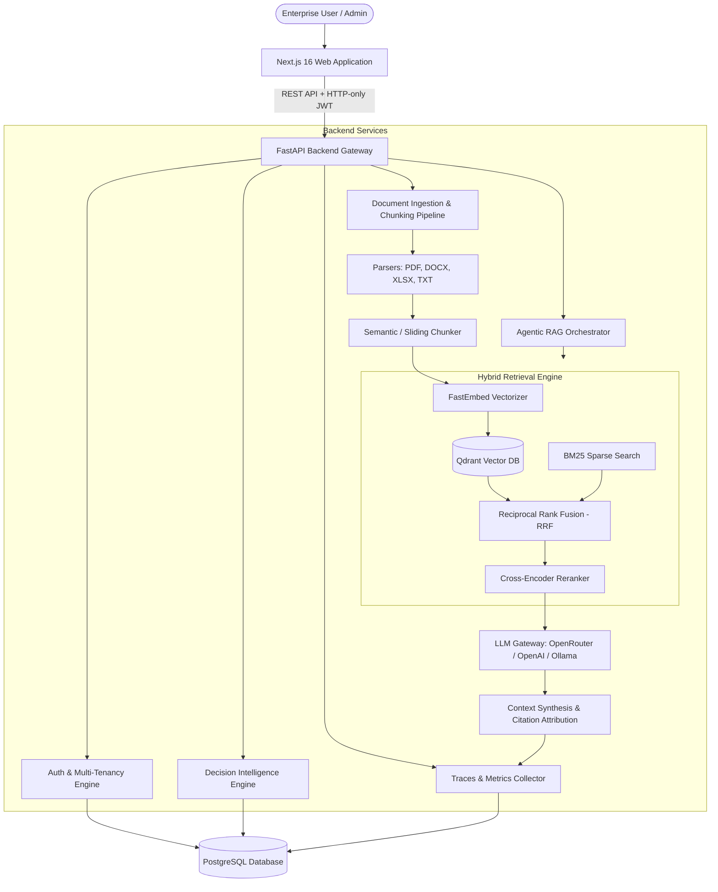

# Enterprise Agentic RAG & Decision Intelligence Platform

[](https://www.python.org/)
[](https://fastapi.tiangolo.com/)
[](https://nextjs.org/)
[](https://www.typescriptlang.org/)
[](https://www.postgresql.org/)
[](https://qdrant.tech/)
[](LICENSE)

An enterprise-grade, multi-tenant **Agentic Retrieval-Augmented Generation (RAG) and Decision Intelligence System**. Designed for mission-critical knowledge bases, policy exploration, and autonomous multi-step reasoning, this platform combines hybrid vector-lexical retrieval, automated document ingestion, verifiable source attribution, and deep execution observability.

---

## Table of Contents

- [Key Architecture & Capabilities](#key-architecture--capabilities)
- [System Architecture](#system-architecture)
- [Directory Structure](#directory-structure)
- [Getting Started](#getting-started)
  - [Prerequisites](#prerequisites)
  - [1. Infrastructure Services (Docker)](#1-infrastructure-services-docker)
  - [2. Backend Setup](#2-backend-setup)
  - [3. Frontend Setup](#3-frontend-setup)
- [Configuration Reference](#configuration-reference)
- [API Endpoints](#api-endpoints)
- [Testing & Quality Assurance](#testing--quality-assurance)
- [Contributing & License](#contributing--license)

---

## Key Architecture & Capabilities

### 1. Hybrid Retrieval Engine (Dense + Sparse + RRF)
- **Dense Vector Search**: Powered by [Qdrant](https://qdrant.tech/) with local on-device embeddings via [FastEmbed](https://github.com/qdrant/fastembed) (`sentence-transformers/all-MiniLM-L6-v2`, 384 dimensions).
- **Sparse Lexical Search**: Custom BM25 implementation for high-precision exact keyword, code, and policy matching.
- **Reciprocal Rank Fusion (RRF)**: Combines dense semantic scores and sparse lexical ranks using reciprocal rank fusion ($k=60$) to eliminate retrieval blind spots.
- **Cross-Encoder Reranking**: Re-scores top-$K$ candidate chunks to ensure only the highest relevance passages reach context synthesis.

### 2. Autonomous Agentic RAG Orchestrator
- **Dynamic Query Routing**: Identifies query complexity (simple lookups vs. multi-hop analytical synthesis).
- **Iterative Reasoning & Planning**: Decomposes multi-faceted questions into targeted retrieval sub-queries.
- **Context Budgeting**: Sliding window and token-aware context assembly to prevent context saturation.
- **Verifiable Citations**: Every generated statement includes traceable references directly back to source documents, sections, and chunk offsets.

### 3. Multi-Format Document Ingestion Pipeline
- Native parsing support for **PDF** (`PyMuPDF`), **DOCX** (`python-docx`), **Excel Spreadsheets** (`pandas` & `openpyxl`), and plain **TXT**.
- Configurable chunk size (1,000 chars) and overlap (200 chars) preserving paragraph boundaries and tabular data integrity.
- Immediate asynchronous background vector indexing into isolated tenant collections.

### 4. Decision Intelligence Engine & Auditability
- Synthesizes risk assessments, comparative alternatives, and evidence-backed recommendations.
- Full persistent history of decisions, queries, user feedback, and rationale logs.

### 5. Full-Stack Observability & Tracing
- Granular per-step execution traces: planning, sub-query generation, dense/BM25 retrieval latencies, reranking duration, and LLM generation time.
- Dedicated Traces UI for visualizing query lifecycles, debugging pipeline bottlenecks, and auditing agent decisions.

### 6. Multi-Tenant Security & Enterprise Isolation
- Strict organizational data isolation enforced across PostgreSQL and Qdrant payloads.
- Role-Based Access Control (RBAC) with secure HTTP-only cookies and JWT authentication.
- Argon2id cryptographic password hashing.

---

## System Architecture



---

## Directory Structure

```plaintext
.
├── backend/
│   ├── alembic/              # Database migration scripts & history
│   ├── alembic.ini           # Alembic migration configuration
│   ├── app/
│   │   ├── api/              # API router & versioned v1 endpoints
│   │   │   └── v1/
│   │   │       ├── deps.py   # Auth, DB, and context dependencies
│   │   │       └── endpoints/# Auth, Docs, RAG, Retrieval, Traces, Decisions
│   │   ├── core/             # Configuration, settings, security & hashing
│   │   ├── db/               # PostgreSQL models, async engine & Qdrant client
│   │   ├── llm/              # LLM client abstractions (OpenRouter, Ollama)
│   │   ├── schemas/          # Pydantic data validation schemas
│   │   └── services/         # Ingestion, RAG, Retrieval, and Decision services
│   ├── tests/                # Comprehensive pytest suite
│   ├── evaluate_rag.py       # RAG end-to-end evaluation benchmark
│   ├── evaluate_retrieval.py # Dense vs. BM25 vs. Hybrid retrieval benchmarks
│   ├── demo_e2e.py           # Multi-tenant end-to-end integration demo script
│   ├── requirements.txt      # Python dependencies
│   └── .env.example          # Backend environment template
├── frontend/
│   ├── public/               # Static assets & icons
│   ├── src/
│   │   ├── app/              # Next.js App Router (Chat, Documents, Decisions, Traces)
│   │   ├── components/       # Reusable UI & layout components
│   │   ├── hooks/            # Client authentication & state hooks
│   │   └── lib/              # API client & utility functions
│   ├── package.json          # Frontend dependencies & scripts
│   └── .env.example          # Frontend environment template
├── docker-compose.yml        # Multi-container orchestration (PostgreSQL & Qdrant)
├── .gitignore                # Production-grade git ignore configuration
├── LICENSE                   # MIT License
└── README.md                 # Project documentation
```

---

## Getting Started

### Prerequisites

Ensure the following tools are installed on your host system:
- [Docker](https://www.docker.com/) & Docker Compose
- [Python 3.11+](https://www.python.org/)
- [Node.js 18+](https://nodejs.org/) & `npm`

---

### 1. Infrastructure Services (Docker)

Spin up the PostgreSQL database and Qdrant vector database using Docker Compose:

```bash
docker compose up -d
```

Verify services are healthy:
- **PostgreSQL**: `localhost:5432`
- **Qdrant Vector DB**: `http://localhost:6333` (Web UI at `http://localhost:6333/dashboard`)

---

### 2. Backend Setup

1. **Navigate to the backend directory and activate a virtual environment**:
   ```bash
   cd backend
   python -m venv .venv
   
   # Windows (PowerShell):
   .venv\Scripts\Activate.ps1
   # Linux / macOS:
   source .venv/bin/activate
   ```

2. **Install Python dependencies**:
   ```bash
   pip install -r requirements.txt
   ```

3. **Configure environment variables**:
   ```bash
   cp .env.example .env
   ```
   *Edit `.env` to configure your `LLM_API_KEY` (e.g. OpenRouter or OpenAI) and secret keys.*

4. **Apply database migrations**:
   ```bash
   alembic upgrade head
   ```

5. **Start the FastAPI backend server**:
   ```bash
   uvicorn app.main:app --host 0.0.0.0 --port 8000 --reload
   ```

Interactive API documentation will be available at:
- Swagger UI: `http://localhost:8000/docs`
- ReDoc: `http://localhost:8000/redoc`

---

### 3. Frontend Setup

1. **Navigate to the frontend directory**:
   ```bash
   cd ../frontend
   ```

2. **Install Node packages**:
   ```bash
   npm install
   ```

3. **Configure environment variables**:
   ```bash
   cp .env.example .env.local
   ```

4. **Start the Next.js development server**:
   ```bash
   npm run dev
   ```

Open `http://localhost:3000` in your browser.

---

## Configuration Reference

Key configuration settings available in `backend/.env`:

| Variable | Default Value | Description |
| :--- | :--- | :--- |
| `POSTGRES_HOST` | `localhost` | PostgreSQL host address |
| `POSTGRES_PORT` | `5432` | PostgreSQL database port |
| `POSTGRES_DB` | `rag_db` | Application database name |
| `QDRANT_HOST` | `localhost` | Qdrant host address |
| `QDRANT_PORT` | `6333` | Qdrant HTTP port |
| `EMBEDDING_MODEL` | `sentence-transformers/all-MiniLM-L6-v2` | FastEmbed embedding model |
| `DENSE_TOP_K` | `20` | Number of dense candidates retrieved |
| `BM25_TOP_K` | `20` | Number of lexical candidates retrieved |
| `FINAL_TOP_K` | `10` | Top candidates passed to reranker |
| `RRF_K` | `60` | Reciprocal Rank Fusion constant |
| `RERANK_TOP_K` | `5` | Final top chunks injected into context |
| `LLM_PROVIDER` | `openrouter` | Provider (`openrouter`, `openai`, `ollama`) |
| `LLM_MODEL` | `nvidia/nemotron-3-super-120b-a12b:free` | Model identifier |

---

## API Endpoints

| Method | Endpoint | Description |
| :--- | :--- | :--- |
| `POST` | `/api/v1/auth/register` | User registration |
| `POST` | `/api/v1/auth/login` | User login (issues secure HttpOnly cookie) |
| `GET`  | `/api/v1/auth/me` | Fetch active authenticated user profile |
| `POST` | `/api/v1/organizations/` | Create and manage multi-tenant organizations |
| `POST` | `/api/v1/documents/upload` | Upload & ingest document (PDF, DOCX, XLSX, TXT) |
| `GET`  | `/api/v1/documents/` | List tenant documents and indexing status |
| `POST` | `/api/v1/retrieval/query` | Direct hybrid retrieval test endpoint |
| `POST` | `/api/v1/rag/query` | Execute end-to-end Agentic RAG query |
| `GET`  | `/api/v1/decisions/` | Retrieve decision logs and audit history |
| `GET`  | `/api/v1/traces/{id}` | Inspect per-step query execution trace |
| `GET`  | `/health` | Service health status |

---

## Testing & Quality Assurance

### Run Unit & Integration Tests

The test suite covers authentication, organization isolation, embedding generation, dense & BM25 retrieval, RRF fusion, reranker performance, document ingestion, and decision engines:

```bash
cd backend
pytest tests/ -v
```

### Run Retrieval & RAG Benchmarks

Benchmark retrieval precision and synthesis accuracy:

```bash
python evaluate_retrieval.py
python evaluate_rag.py
```

### Run End-to-End Demo Script

Simulates multiple organizations, concurrent users, document uploads, and agentic queries:

```bash
python demo_e2e.py
```

---

## Contributing & License

Distributed under the [MIT License](LICENSE). Contributions, feature suggestions, and bug reports are welcome!
